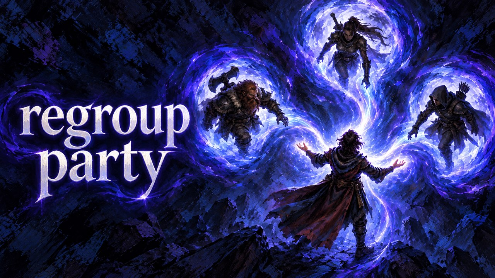

# Regroup

Adds the Regroup spell to every character: it teleports the whole party to the caster.

## What it does

- Every party member and every camp companion gets the spell **Regroup**: from the start, and each new party member
  when it joins.
- Regroup teleports all your party members and their summons to you. Each one lands on its own free spot around you,
  so nobody stands inside another character.
- It is free and works only outside combat.
- Party members that are in combat stay where they are. Camp companions stay in camp.

## Screenshots

## How to install

1. Install [Norbyte's Script Extender](https://github.com/Norbyte/bg3se). It updates itself.
2. Download `bg3_regroup.pak` from the latest release on GitHub.
3. Copy it to `%LOCALAPPDATA%\Larian Studios\Baldur's Gate 3\Mods`.
4. Enable **Regroup** in your mod manager (BG3 Mod Manager or the in-game mod manager).

To update the mod, replace the `.pak` with the one from the new release. To remove it, disable it in the mod manager
and delete the `.pak`. Saves made with the mod can then show a warning about a missing mod.

## How to use

Cast **Regroup** from the spells of any party member, outside combat. The party appears around that character.

## Compatibility

- Game version: Patch 8
- The mod adds a new spell and changes no game entries, so it does not conflict with other mods.

## Known issues

None yet.

## How to build

Anyone can build this mod from its source code and check that the download matches it.

1. Install the tools: Windows PowerShell 5.1 (part of Windows) and [LSLib](https://github.com/Norbyte/lslib/releases)
   v1.20.4. Put LSLib into a folder `_tools\lslib\` above the repository, or set `BG3_TOOLS` to the folder that holds
   `lslib\`.
2. Build it: `powershell -ExecutionPolicy Bypass -File .\build.ps1`
3. Find the file: `dist\bg3_regroup.pak`

The offline tests need Python 3 with lupa: `python -m pip install lupa`, then `python tests\run_tests.py`.

## Credits

Made by Kintaro. MIT license: you may use, change and share this mod.
